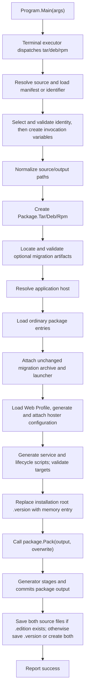

# Zongsoft.Tools.Packager implementation

[English](implementation.md) | [简体中文](implementation.zh-Hans.md)

This document is for maintainers. It describes the source structure, command pipeline, package model, file collection rules, systemd script generation, and current implementations of the `.tar.gz`, `.deb`, and `.rpm` formats.

For installation, configuration, and release workflows, see the [packager README](../README.md).

Application examples use the real [Zongsoft.Hosting.Web](https://github.com/Zongsoft/hosting/tree/main/web/default) host. Staging directories, the Bash working directory, and example versions follow the [README quick start](../README.md#quick-start). The host DLL is `Zongsoft.Hosting.Web.dll`; `--daemon:zongsoft.web` selects the package and service identity. Automatic Web configuration uses the host's web.profile; the root-alias section separately demonstrates ordinary payload with a user-supplied manual.conf.

The hosting root scripts select the host with source and accept a framework override. When omitted, the tool resolves framework from its variable providers; `--compilation` supplies the build configuration. Daemon declares `Environment,DOTNET_ENVIRONMENT` for generated services; Web also declares `ASPNETCORE_ENVIRONMENT`. Terminal disables daemon support, so the variable list does not set an interactive process environment. Building, deploying, and creating migration artifacts happen outside this tool; standalone `pack.cmd` only collects existing payloads. See the [quick start](../README.md#quick-start) for script setup and commands.

## Design goals

`Zongsoft.Tools.Packager` generates Linux application packages in .NET, minimizing build-time dependencies on platform packaging tools.

The main design choices are:

- Expose one `dotnet-pack` entry point with `tar`, `deb`, and `rpm` subcommands.
- Share application metadata, variable expansion, file collection, script generation, and naming across formats.
- Use systemd as the default service model for .NET background and Web services.
- Write package primitives directly instead of invoking `tar`, `dpkg-deb`, `rpmbuild`, or `cpio`.
- Generate Linux packages on Windows, Linux, or macOS; preserve Unix permissions on Unix hosts and apply defaults on Windows.

## Source structure

| File | Responsibility |
| --- | --- |
| `Program.cs` | Initialize the terminal command tree and register `TarCommand`, `DebCommand`, and `RpmCommand`. |
| `PackCommand.Version.cs` | The nested `VersionFile` reads the source version, validates identity, selects an Edition, and saves after success. |
| `PackCommand.cs` | Template-method base for all three commands; declare common options and coordinate execution. |
| `PackCommand.Tar.cs` | Create `Package.Tar`. |
| `PackCommand.Deb.cs` | Create `Package.Deb`. |
| `PackCommand.Rpm.cs` | Create `Package.Rpm` and parse RPM-specific `provides` and `conflicts`. |
| `Package.cs` | Package, installation-script, and entry models, plus file collection. |
| `Package.Tar.cs` | Default installation path, filename, and entry point for `.tar.gz`. |
| `Package.Deb.cs` | Default installation path, filename, and entry point for `.deb`. |
| `Package.Rpm.cs` | Default installation path, filename, and RPM-specific properties. |
| `Generator.cs` | Compute generator identity from the current assembly for metadata in all three formats. |
| `Generator.Tar.cs` | Write gzip PAX tar, `install.sh`, and `uninstall.sh`. |
| `Generator.Deb.cs` | Write the Debian `ar` container, `control.tar.gz`, and `data.tar.gz`. |
| `Generator.Rpm.cs` | Write the RPM lead, signature/header, metadata header, and gzip cpio payload. |
| `Migration.cs` | Locate external migration artifacts by final application identity, validate PAX metadata, attach unchanged files, and provide installation coordination scripts. |
| `ApplicationHost.cs` | Resolve the application host and existing or generated service once. |
| `Scriptor.Systemd.cs` | Generate/collect systemd units and compose application, migration and Web lifecycle scripts. |
| `Web/Definition*.cs` | Collect [Zongsoft.Core](https://github.com/Zongsoft/framework/tree/main/Zongsoft.Core) Profile declarations and resolve replacement, inheritance, variables and validation. |
| `Web/Configurator*.cs` | Configurator contract, Nginx directive model/validation, deterministic serialization and relocatable content. |
| `Web/Installation*.cs` | Validate generated targets and provide delivery, relocation, activation and removal scripts. |
| `Utility.cs` / `TextSource.cs` | Expand variables on demand and resolve files under the source directory or literal text. |
| `Utility.Search` / `Generator.Entries.cs` | Match path segments, handle directory metadata, and manage temporary payload streams. |
| `PackageOptions.cs` | Typed packaging options, template evaluation and tool defaults; Core manages the variable providers. |
| `Dependency.cs` | Parses uniform dependency intervals and alternative groups for native Debian/RPM relationship output. |
| `Utility.cs` | RID, installation path, path normalization, Unix timestamps, and file permissions. |
| `Dumper.cs` | Console splash, error, and warning output. |
| Linked `tools/.shared` source | `Utility.cs` compiles with this project's `partial Utility`, sharing recursive variables and command/text helpers. `ArtifactPublisher` manages staging and publication: atomic replacement for single files, grouped commit and recovery for multiple files. Boolean switches use [Zongsoft.Core](https://github.com/Zongsoft/framework/tree/main/Zongsoft.Core) `Switch`; enums use [Zongsoft.Core](https://github.com/Zongsoft/framework/tree/main/Zongsoft.Core) conversion without checking whether a member is defined. No shared DLL is produced. |

## Execution pipeline

Command structure:

```text
dotnet-pack
├── tar
├── deb
└── rpm
```

`PackCommand<TPackage>.OnExecuteAsync()` coordinates the pipeline:



`PackCommand<TPackage>` performs common work; subclasses create the concrete `Package`:

```csharp
protected override Package.Deb CreatePackage(CommandContext context, PackageOptions options)
```

`RpmCommand` also reads:

- `--provides`
- `--conflicts`

These options are split on commas or semicolons and written into the RPM metadata header.

## Source and packaged versions

`VersionFile` opens the source directory's direct `.edition` with `File.OpenRead` and `ApplicationManifest.Load(Stream)`. Only `FileNotFoundException` permits the fallback `.version`, parsed by `ApplicationIdentifier.Load(Stream)`; an empty identifier, corrupt file, directory placeholder or other I/O error stops the command. Neither parser searches other directories.

Manifest selection is explicit nonblank Edition, then Current, then the sole Edition. Multiple Editions without a selection fail; no named Editions means the top-level version. Explicit selection must exist and retains canonical spelling. Identifier fallback allows an explicit Edition to replace or add the identifier's Edition. Source names must match explicit names case-insensitively; the explicit version overrides the selected nonzero version. Identity options alone determine identity, with environment and `.env` available only through explicit variable references.

The loaded manifest is updated in memory: replace the selected Edition in place, then set Current to it. Other entries, order and [Zongsoft.Core](https://github.com/Zongsoft/framework/tree/main/Zongsoft.Core)'s comment/blank-line layout survive. The save content is prepared before packaging; `Save(TextWriter)` receives a UTF-8-without-BOM writer with CRLF. Identifier bytes come from `ApplicationIdentifier.Save(Stream)`. Reading uses `ApplicationIdentifier.Load`, which accepts identifiers with or without a trailing LF or CRLF; validation checks the parsed identity rather than trailing newline bytes.

After all package output commits, manifest input writes both `.edition` and `.version` through `ArtifactPublisher` as a group, replacing any existing identifier or creating it if missing. The identifier records the final selected name, Edition and version. Identifier-only input atomically updates only `.version`. With neither input, valid explicit name/version are required and both files are staged and committed together without overwriting concurrently created files. Failures restore the pair. Source save failure retains the package and reports the affected paths; parse, validation and package failures never save source files.

`EntryCollection.Load` excludes the direct source `.edition`, including explicit aliases. File entries targeting the installation-root `.edition` are omitted too; other subdirectory files retain ordinary selection rules. `SetVersion` writes a unique installation-root `.version` memory entry in mode `0644`, replaces same-target ordinary and rooted entries, and bypasses exclusions. All encoders and RPM digests use `Entry.OpenRead()`; nested `.version` files remain ordinary payload.

Debug references the local [Zongsoft.Core](https://github.com/Zongsoft/framework/tree/main/Zongsoft.Core) build and Release references the centrally configured NuGet package. Both must provide `ApplicationManifest`, `Editions.Current` and `ProfileOptions.Directives`; Web loading uses `ProfileDirectiveBehavior.Strict` to require imports.

## Command option model

Required and conditionally required options:

| Option | Type | Description |
| --- | --- | --- |
| `--name` | `string` | Required without a source version file; otherwise validate against or use the source name. |
| `--version` | `string` | Expand, then convert to `System.Version`; required without a source file, otherwise override the selected version. The final version must be nonzero. |
| `--platform` | `string` | Expand, then convert to `Platform` to select the target platform. |

Common optional settings:

| Option | Default | Description |
| --- | --- | --- |
| `--source` | Current directory | Input directory. |
| `--migration` | Empty | Original migration input name, optionally with a directory; bare names search source and ancestors plus each direct `.migration/` child using final Edition, Version, and Runtime. |
| `--output` | `source` | Always an output directory; relative paths use `source`. A filename cannot be specified. |
| `--exclude` | Empty | Comma- or semicolon-separated patterns skipped during entry collection. |
| `--edition` | Current or the sole Edition | Product Edition, included in the package name. |
| `--framework` | `framework` variable or empty | Optional .NET target framework used to locate the host under `bin/<compilation>/<framework>`; omitted command options defer to lower-priority providers; explicit empty values stop fallback. |
| `--compilation` | `Release` | Optional .NET build configuration used for that host lookup and available as a variable. |
| `--architecture` | `x64` | Target architecture. |
| `--overwrite` | `false` | Replace existing output files. |
| `--install-path` | Derived from package identity | Installation directory. |
| `--title` | Empty | Human-readable title. |
| `--summary` | Empty | Short description or file path. |
| `--description` | Empty | Long description or file path. |
| `--homepage` | `https://github.com/Zongsoft` | Project homepage. |
| `--license` | Empty | License text. |
| `--category` | Format default | Debian `Section` or RPM `Group`. |
| `--maintainer` | `Zongsoft` | Package maintainer. |
| `--manufacturer` | `Zongsoft` | Software manufacturer; missing, null, and empty values use the default, but whitespace alone does not. |
| `--dependencies` | Empty | Uniform `name[:range]` dependency list; interval syntax with `[v)` shorthand and `|` alternatives. |

Systemd and lifecycle options:

| Option | Description |
| --- | --- |
| `--daemon` | Systemd unit filename/identity; `none`, `disable`, and `disabled` disable it. |
| `--daemon-environments` | Comma- or semicolon-separated variable names written into the generated service. |
| `--installing` / `--installed` | Before/after installation scripts. |
| `--uninstalling` / `--uninstalled` | Before/after uninstallation scripts. |
| `--preinstalling` / `--postinstalling` | Prepend/append to `installing`. |
| `--preinstalled` / `--postinstalled` | Prepend/append to `installed`. |
| `--preuninstalling` / `--postuninstalling` | Prepend/append to `uninstalling`. |
| `--preuninstalled` / `--postuninstalled` | Prepend/append to `uninstalled`. |

## Variables and normalization

### Variable sources

`PackCommand<TPackage>.CreateEvaluator(context, directory)` combines command options, the supplied directory's `.env` (including explicit imports), and environment variables; the tool enables Fallback, and Core supplies defaults only after all ordinary values miss. Omitting `directory` skips `.env` loading for the initial source resolution. After verifying and resolving the source directory to an absolute path, variables are reloaded and source is fixed; `.env` does not determine source retroactively. Configuration and command-option names ignore case; system environment names follow platform rules. Precedence is explicit options > source `.env` (including explicit imports) > environment > defaults.

Shared `Utility.LoadEnvironmentProfiles` reads only source's direct `.env`, without searching parent or child directories. Other files load through explicit `#@import` directives. `Profile.Load` preserves [Zongsoft.Core](https://github.com/Zongsoft/framework/tree/main/Zongsoft.Core) empty-value and import semantics; section levels form dot-separated namespaces and entry dots/hyphens become underscores. Read/parse failures stop packaging; only missing files are skipped. Process environment variables are not changed.

The variable contract is `Zongsoft.Common.IVariables`. Command options use `context.Options` directly, while computed values use Core `Variables`; `.env` files remain `Profile.ToVariables()` views. System values are read live through `Variables.Environments()`, without copying or rewriting names or values. The environment provider exposes only the default namespace; Windows ignores name case and Unix/Linux preserves case sensitivity. Path values used in templates use `/`; other escaping follows Core. The tool explicitly sets `TemplateEvaluatorOptions.Fallback=true`. It searches every provider at each namespace before moving through parents to global, then allows source-declared defaults. The first match wins, including null. Directive evaluation inherits Fallback, Recursive, Culture and MaximumDepth from its evaluator; unqualified references need no extra syntax. Use `${name}` or `${io.rustfs:access_key}`. Section levels form dot-separated namespaces; entry and command-option dots/hyphens become underscores. Invalid configuration names supply no variable and ambiguous configuration names fail only when queried.

Register context.Options once before configuration and the environment. Core VariablesExtension.TryGetValue queries all sources at each namespace with false. Only after global ordinary queries also miss does it query global with true for declared defaults. Global precedence is explicit options, the source directory's .env (including explicit imports), environment, then option defaults. HasDefaultValue distinguishes omission from explicit null; omission does not synthesize a type's zero value. Raw reads, recursive templates and directive evaluation share the Fallback setting. Computed overrides use a leading Variables source.

Templates use Core `TemplateEvaluator.Evaluate` / `TryEvaluate` directly, with `Recursive` enabled and the default depth limit of 64, counting the root and recursive strings. Every input follows Core escaping: `\${name}` emits a literal reference and `\\` emits a literal backslash. Prefer relative paths; use `/` in absolute paths, for example `../.shared/${product}.env` or `D:/deploy/${scheme}`. Missing variables, cycles and excessive depth follow the Core error contract.

`.env` directive arguments are evaluated through `Directives.Processing`, looking up explicit options, already-read entries in the current file (including completed imports), and environment/default values in that order. Later declarations are unavailable; an imported file does not implicitly search its parent's local entries. Maker manifest callbacks query actual invocation values before the current Profile, then descriptor defaults only if all sources miss. Each import uses its complete argument as one path. Source declarations and raw entries remain unchanged; tools explicitly request evaluation while Profile handles reading and imports.

All variables, including `framework`, use the first successful lookup: null, empty strings, false and zero never trigger fallback to a lower source. Only a missing value continues lookup. Operations requiring a valid value validate it and report an error when they cannot proceed.

`PackCommand` creates an invocation-local `PackageOptions` object and passes it to packages, scripts, and text sources. It keeps no process-wide variable state. References expand recursively when accessed; unused unknown references do not prevent packaging. Unknown variables, cycles, and expansion deeper than 64 levels fail with a diagnostic naming the variable. Expansion itself does not read files.

[Zongsoft.Core](https://github.com/Zongsoft/framework/tree/main/Zongsoft.Core) command descriptors retain options that may contain variables as strings. `source` expands first using the complete raw variable set. Explicit `name`, `edition`, and `version` then expand; `version` is converted to `System.Version` to select the version from the source `.edition` manifest or `.version` identifier. After identity is finalized, `platform`, `architecture`, and `overwrite` expand and convert when used. Bare `--overwrite` remains true; omission defaults to false.

Identity still comes from the source `.edition` manifest or `.version` identifier and explicit name/edition/version options; same-named environment or `.env` variables do not implicitly replace identity. Explicit options may reference other `.env` variables. Final identity and resolved source/output overwrite the variable collection. `--migration` requires explicit activation; `--overwrite` can come from the environment or `.env` and be overridden on the command line.

### Variable syntax

Core `TemplateEvaluator` accepts:

```text
${name}
${namespace:name}
```

Example:

```bash
export APP_NAME=Zongsoft.Hosting.Web
export APP_VERSION=1.0.0

dotnet-pack deb \
  --daemon:zongsoft.web \
  --name:"$APP_NAME" \
  --version:"$APP_VERSION" \
  --platform:linux \
  --framework:net10.0 \
  --source:./publish \
  --output:../packages/
```

Bash expands the identity options in this example. `--version` enters `OnExecuteAsync` as a string and becomes `System.Version` only after expansion; name and Edition are validated from supplied values. Packager expressions can also appear in subsequent paths, text, and migration configuration.

Unknown variables in source paths, output, payload, exclusions, text, or migration input fail; unused variables remain unexpanded. `TryEvaluate` returns the original Core error; callers must not continue with failed input.

### Text and files

`TextSource.Read(source, value, options, fileOnly)` handles summary, description, and lifecycle hooks:

- `text:` returns the following content literally, including shell `${___}`, `${___}`, or path-like text.
- `file:` expands the following path and reads it as an absolute path or relative to source; a missing file fails.
- Without a prefix, expand variables first. Multiline values are text; existing files are read relative to source; clearly missing paths fail; other single-line values are text. Prefixes remove ambiguity.
- File content is neither expanded nor interpreted again as another file path.
- Pre/post hooks are file lists separated by `;` or `|`. Each item may use `file:`, but not `text:`. Filenames cannot contain these list separators.

## Package model

The abstract `Package` class holds metadata shared by all formats:

- `Name`
- `PackageIdentity`
- `PackageName`
- `Edition`
- `Version`
- `Platform`
- `Architecture`
- `Runtime`
- `Framework`
- `Title`
- `Summary`
- `Description`
- `Maintainer`
- `Manufacturer`
- `License`
- `Homepage`
- `Category`
- `InstallPath`
- `Dependencies`
- `Entries`
- `Scripts`
- `Migration`

Package names follow:

```text
identity
identity-edition
```

`identity` defaults to `name`. A supplied, enabled `--daemon` instead uses the filename part of the daemon identity, removing an optional `.service` suffix.

`Package.GetFileName` generates output filenames for all three formats. Here `name` means the package `identity`, including the daemon precedence above:

```text
<name>@<version>-<architecture>.<extension>
<name>-<edition>@<version>-<architecture>.<extension>
```

Examples:

```text
zongsoft.web@1.0.0-x64.deb
zongsoft.web-enterprise@1.0.0-x64.rpm
```

Architecture uses `Architecture.ToString().ToLowerInvariant()`, such as `x64` or `arm64`. Extensions are `tar.gz`, `deb`, and `rpm`; filenames contain name, optional Edition, version, and architecture. The tar `.sh` entry uses the same stem. Runtime Identifier matches migration artifacts and is not part of installation-package filenames.

### Runtime Identifier

`Utility.GetRuntimeIdentifier()` combines platform and architecture:

```text
linux + x64   => linux-x64
linux + arm64 => linux-arm64
windows + x64 => win-x64
windows       => win
```

`Platform.Windows` declares `[Alias("Win")]` for command parsing; `Win` is not a separate enum member.

### Default installation path

`Utility.Unix.GetInstallPath(identity)` derives the default installation path:

```text
Zongsoft.Hosting.Web => /opt/zongsoft/hosting/web
zongsoft.web         => /opt/zongsoft/web
```

Rules:

- An empty name returns `/opt`.
- Lowercase the name.
- Replace every dot with `/` to form nested directories.
- Without dots, use `/opt/<name>`.
- The Web example sets `--daemon:zongsoft.web`, yielding `/opt/zongsoft/web`; `--name:Zongsoft.Hosting.Web` still locates the host DLL.

## Loading package entries

`Package.EntryCollection` loads entries.

### Default collection

With no positional arguments:

```text
Recursively collect all files under source
entryName = file path relative to source
```

For `.deb` and `.rpm`, the installation path prefixes `entryName`:

```text
InstallPath = /opt/zongsoft/web
EntryName   = opt/zongsoft/web/Zongsoft.Hosting.Web.dll
```

For `.tar.gz`, `EntryPrefix` is `null`: application files stay at the archive root, and `install.sh` copies them to the destination during installation.

### Explicit collection

Positional arguments use:

```text
path
path:alias
```

Parsing rules:

- Split path and alias at the last colon.
- A Windows drive-letter colon such as `C:` is not an alias separator.
- Relative paths use `source`.
- Absolute paths may be outside `source`; without an alias, only the filename is used in the package.
- Directories expand recursively and are entries themselves, preserving empty directories and source modes (0755 by default on Windows). Directory alias `:~` normalizes to an empty path, placing content directly at the installation root; hosting payload arguments use this form.
- [Zongsoft.Core](https://github.com/Zongsoft/framework/tree/main/Zongsoft.Core) `Searcher` supports `*` and `?` in any path segment; a standalone `**` matches zero or more directory levels. Results at each argument position are sorted Ordinal by paths relative to the fixed prefix, with `/` separators; the complete input sequence is not reordered. Windows matching is case-insensitive, Unix matching case-sensitive.
- Duplicate target paths produce a conflict warning and are skipped.

### Exclusions

`--exclude` applies during `Package.EntryCollection.Load()`:

- Split patterns on commas or semicolons.
- Expand variables, then normalize path separators to `/`.
- Relative patterns use `source`; matching considers the relative source path, final package path, and filename.
- Support `*`, `?`, and `**`; directory patterns such as `logs/` mean `logs/**`.
- Matching files are skipped without duplicate-entry warnings.
- Generated/attached systemd service files and the generated `.version` bypass this filter.

### Root-path aliases

An alias beginning with `/` or `\` marks an entry as `Rooted`.

The following example assumes the user has prepared `publish/manual.conf`. It demonstrates a root-path alias for supplied configuration without enabling `--web`:

```bash
dotnet-pack deb \
  --name:zongsoft.hosting.web \
  --daemon:none \
  --version:1.0.0 \
  --platform:linux \
  --framework:net10.0 \
  --source:./publish \
  --output:../packages/ \
  manual.conf:/etc/nginx/conf.d/zongsoft.web.conf
```

Handling by format:

| Format | Behavior |
| --- | --- |
| `.deb` | Payload path `etc/nginx/conf.d/zongsoft.web.conf` installs at `/etc/nginx/conf.d/zongsoft.web.conf`; rooted files under `/etc` enter `conffiles`. |
| `.rpm` | Payload path `/etc/nginx/conf.d/zongsoft.web.conf` is marked as a configuration file in the RPM header. |
| `.tar.gz` | Store at `.root/etc/nginx/conf.d/zongsoft.web.conf`; `install.sh` copies it to `${DESTDIR}/etc/nginx/conf.d/zongsoft.web.conf`. |

### File permissions

On Unix-like hosts:

```text
File.GetUnixFileMode(path) & rwx mask
```

On Windows, or when usable permissions cannot be read:

- `.sh`, `.dll`, `.exe`, and extensionless files use `0755`.
- Other files use `0644`.

## Systemd generator

All three package types currently use `Scriptor.Systemd`.

A supplied, enabled `--daemon` overrides only the package filename, system package name, and default installation path. `Package.Name` retains `--name` to locate the .NET host DLL.

### Service file resolution

An empty `--daemon` defaults to lowercase `Package.Name` as the service identity, without Edition.

The flow is:

1. Disable service generation for `--daemon:none`, `--daemon:disable`, or `--daemon:disabled`.
2. Otherwise look under `source` for the file specified by `--daemon`.
3. If it exists, add it to package entries.
4. Otherwise generate the `.service` file in memory and add it, without a fixed temporary path. Validate the service filename before adding the entry.

### Host lookup

Generating a `.service` requires locating the .NET host, in this order:

1. `<source>/<name>.dll`
2. The unique `.exe` under `<source>`, inferring a same-named `.dll`
3. `<source>/bin/<compilation>/<framework>/<name>.dll`
4. The unique `.exe` under `<source>/bin/<compilation>/<framework>`, inferring a same-named `.dll`

Steps 3 and 4 are skipped when `framework` or `compilation` is empty or whitespace. Neither option triggers compilation; ordinary file packaging, a .NET host in the source directory, and an existing service file do not require either option. A file-only package can use `--daemon:none` to skip host resolution entirely.

A failed lookup reports:

```text
The daemon host location failed.
```

### Generated service content

A regular service:

```ini
[Unit]
Description=<title-or-name>

[Service]
Type=simple
WorkingDirectory=<install-path>
ExecStartPre=mkdir -p <install-path>/logs
ExecStart=dotnet <install-path>/<host>
Restart=on-failure
RestartSec=10
KillSignal=SIGINT
SyslogIdentifier=<package-identity>
DynamicUser=no
PrivateTmp=no
ReadWritePaths=<install-path> <install-path>/logs /tmp

Environment=DOTNET_NOLOGO=true
<custom-environment-lines>

[Install]
WantedBy=multi-user.target
```

Listeners come from application runtime configuration. Service generation does not append --urls, and existing ExecStart commands remain intact.

### Lifecycle scripts

Script model mapping:

| `Package.InstallScripts` | Debian file | RPM tag | Tar path |
| --- | --- | --- | --- |
| `Installing` | `preinst` | `1023` | Merged into `install.sh` |
| `Installed` | `postinst` | `1024` | Merged into `install.sh` |
| `Uninstalling` | `prerm` | `1025` | Merged into `uninstall.sh` |
| `Uninstalled` | `postrm` | `1026` | Merged into `uninstall.sh` |

Without supplied scripts, defaults are:

- Stop the same-named systemd service before installation.
- Create `/etc/systemd/system/<service>` as a symbolic link after installation.
- Run `systemctl daemon-reload`, `systemctl enable`, and `systemctl start` afterward.
- Disable and stop the service before uninstallation.
- Remove the service link, reload systemd, and remove the installation directory after uninstallation.

With systemd disabled, application service operations become no-ops. Migration and Web delivery/activation/removal steps remain independent; uninstallation still removes the installation directory.

Each format guards uninstallation differently:

- Debian `prerm` runs `Uninstalling` only for `remove` or `deconfigure`; `postrm` runs `Uninstalled` only for `remove` or `purge`. `upgrade`, `failed-upgrade`, `abort-install`, `abort-upgrade`, and `disappear` do not run uninstall cleanup.
- RPM `%preun` and `%postun` run uninstall scripts only when `$1=0`, meaning the last installed instance is being removed. `$1>0` preserves the installed payload.
- Tar enters uninstallation only through explicit `uninstall.sh` execution. The generator removes the resolved `TARGET`; the default `Uninstalled` script performs no additional directory deletion.

## Web configuration and installation integration

See the [Web guide](web.md) for syntax and deployment requirements. Types remain in this project's Web namespace: Definition for declarations/effective models, Configurator.Context/Result and nested Configurator.Nginx. No dynamic plugin loader is introduced.

Definition.cs provides the Load/Resolve entry points. Definition.Loader.cs collects declarations, arranges sections and validates structure. Definition.Resolver.cs merges declarations, evaluates values and builds the effective model, with regions for bindings/resources, backend policies, health checks, headers, native directives and basic value parsing. Value conversion belongs to Resolver rather than a separate Values file. Definition.Model.cs holds the model types.

Loading uses [Zongsoft.Core](https://github.com/Zongsoft/framework/tree/main/Zongsoft.Core) Profile.Load with Directives = { ProfileDirectiveOptions.Import(ProfileDirectiveBehavior.Strict) }. Loading collects the referer before merging; Loaded collects every completed source, including the root. Both retain Profile instance identity. Backend pools replace whole groups by input instance rather than enumerating all final merged entries. Structure is validated first, selected-hoster overrides next, and only consumed values are expanded. Directive arguments and consumed values use the shared Core template evaluator and its escaping rules.

Resolver produces immutable site, route and policy records. Routing combines application declarations by request kind and literal base path, selects an implementable upstream and keeps actual listeners separate from connection targets. Nginx builds a directive tree, validates native context/cardinality, static listener conflicts and structured binding relationships, then emits UTF-8, Tab and CRLF. Installation-root references are typed ContentPart values, not text placeholders that can collide with input. Common literal values never silently become runtime expressions; unrepresentable values fail.

ApplicationHost resolves the host and service once before ordinary payload collection. Generated entries use Entry.OpenRead. Installation.Validate/ValidateEntry check normalized destination conflicts, aliases and ancestor/descendant paths in either insertion order. Failed publication does not save source versions; Profile input is never saved.

Package.InstallScripts.Delivered is separate from the four lifecycle phases. Tar runs it after payload copying and before the DESTDIR-gated Installed stage. Debian runs Delivered/Installed only in postinst configure; RPM runs them in %post. Generated .conf files are replaceable payloads without DEB conffile or RPM config flags.

Phase composition:

- Delivery: prune obsolete generated files and matching owned links; Tar reconstructs installation-root references with INSTALL_PATH. DESTDIR changes only write locations, never configuration paths or system links.
- Post-install: preinstalled → migration preparation/apply (if selected) → installed → Web activation → postinstalled. Failure stops later steps. Custom main hooks and daemon:none do not suppress Web steps.
- Pre-remove: preuninstalling → Web unlink/optional validation and reload → uninstalling → postuninstalling.
- Post-remove: payload removal → preuninstalled → uninstalled → .web cleanup → postuninstalled. Existing format guards skip old-version upgrade removal.

HOSTER_WEB_ACTIVATION is read at installation time. Activation targets default nginx.conf/nginx.service; nginx -T confirms inclusion. Stopped services are validated without starting; running services reload. Installation failures propagate. During ordinary removal, Nginx errors warn and continue, while file-operation failures still fail. Disabled activation never suppresses payload delivery, obsolete-file pruning or final removal.

Cleanup fragments are also generated when the new package has no Web result, so omitting --web can remove obsolete sites. Nginx is called only when current or old Web artifacts are involved. The .web layout itself is the container discovery contract, with .conf.template companions and no .hoster.

Tests cover declarations/models, native output, actual three-format archive decoding and isolated Shell doubles. Shell fixtures replace system paths with temporary directories and use fake nginx/systemctl commands, without installing packages or touching real services. On Windows, `PACKAGER_TEST_GIT`, PATH, Git installation records, and common installation locations select Bash and cygpath from the same installation. The fixture sets `MSYS=winsymlinks:nativestrict` and converts Windows paths through `cygpath -u`, so mount aliases such as `/tmp` agree with resolved link targets. A temporary-directory probe checks required utilities and symbolic-link support before running shell tests; unsupported environments are reported as skipped rather than blocking the build or release. After that probe succeeds, script failures and assertion failures still fail tests. Regression tests cover mount mappings with spaces, portable installations, incomplete tool pairs, and unavailable tools. These tests do not establish real installation validation; target Linux, Nginx modules, certificate loading, and reload behavior require an isolated environment with actual dependencies. See the [Web configuration guide](web.md) for configuration contracts, module requirements, and deployment behavior.

## Application metadata

The option and variable name for the home page is `homepage`; `Package.Homepage` supplies tar PAX `Homepage`, Debian `Homepage`, and RPM `URL` (1020). Tar PAX `Maintainer`, Debian `Maintainer`, and RPM `PACKAGER` (1015) retain the package maintainer independently of the generator identity. `manufacturer` supplies `Package.Manufacturer`, with the shared default `Zongsoft` when absent, null, or empty after expansion. Whitespace-only values remain whitespace. The default for the `maintainer` option is also `Zongsoft`; the two values remain independent.

Tar writes manufacturer as the PAX global attribute `Manufacturer`, Debian writes the custom control field `Manufacturer`, and RPM writes the standard `VENDOR` string tag (1011). Debian keeps its existing text normalization, including omission of a whitespace-only manufacturer field. These fields add no payload entries. See [Debian user-defined fields](https://www.debian.org/doc/debian-policy/ch-controlfields.html#user-defined-fields) and the [RPM tag reference](https://rpm.org/docs/latest/manual/tags.html).

## Packager version metadata

The complete field mapping is in [README application metadata](../README.md#application-metadata). `Generator.GetSummary` chooses the first nonblank Summary, Title, or application Name; `GetDescription` uses a nonblank Description or that effective summary. All three generators use these helpers. Debian combines a normalized one-line synopsis with independent long-description continuation lines, preserving internal indentation and encoding blank lines as ` .`; if both texts are identical, only the synopsis is written. Tar escapes its two text values, while RPM retains literal text. Blank License and Homepage values are omitted in every format. Debian's required Maintainer fallback (`Unknown`) and native category defaults (`utils` / `Applications/System`) remain format-specific.

Debian adds `PackageSize` in invariant-culture bytes alongside its native KiB `Installed-Size`, and adds `InstallPath`. RPM adds the nonblank installation path as application string tag `1000003`, retaining deprecated tag `1056` for existing readers. The application tag is informational: adding `PREFIXES` would advertise relocation support that the lifecycle scripts do not provide. Modern RPM query formats do not expose unregistered application tags or the deprecated `DEFAULTPREFIX` name; readers must inspect the numeric header entries.

The shared BindingDocument model produces JSON .bindings in the installation root. Each generator calls EntryCollection.SetBindings before publication, adding a regular file with mode 0644 and epoch time to size totals and file lists. Containerizer locates and validates it under the installation root. Limits are 1 MiB of logical UTF-8 and depth 32; duplicate entries and links fail. See the [format specification](#binding-document) for the contract and implementation boundaries. PackCommand invokes BindingExtractor for application bindings; Web/Routing composes sites from application declarations, and the Nginx generator adds effective frontend bindings, request-kind routes, targets and policy to the same document.

### Application binding extraction

BindingExtractor runs after selection, exclusions, target mapping and generated entries, before artifact publication and source version saving. PackageFiles maps relative tar entries under InstallPath and deb/rpm or rooted entries to their final absolute installation paths, providing the same virtual root for all formats. Only final payload entries are exposed. PhysicalPath is null and BufferedStream wraps each entry stream so Core does not reinterpret FileStream as a physical source. PackageFiles is limited to virtual file access.

The private ProcessInstruction callback in [BindingExtractor.Configuration.cs](../src/BindingExtractor.Configuration.cs) marks zongsoft.tools.binding instructions as handled and rewrites Import / paths to equivalent relative paths. It shares the private NormalizePath helper with PackageFiles; Core still owns scope, overrides, optional missing files, cycles and depth. Binding values are evaluated after loading, outside this callback, without registering a global Core instruction processor.

Each final .option loads independently. After imports finish, extraction reads the provider's Instructions. An exact path selects one item; a terminal /* selects direct children. filter runs before template/protocols. ConfigurationView uses Core TemplateEvaluator's Resolving callback and MemberExpression for explicit option navigation. String paths are relative to the candidate unless prefixed with /, which starts at this configuration root. Only an explicit string index on a selected field parses Settings; TryGetValue distinguishes missing and empty values. The evaluator has no environment/command sources, recursion or fallback.

Shared FilterExpression handles condition splitting, negation, candidate matching and left-to-right combination; deployer retains variable lookup and TFM comparison. separators splits the evaluated address text; commas split protocols. Core network values and BindingDocument normalize the results. Candidates are grouped by base path and protocol set, then groups sharing endpoints merge transitively. Disjoint endpoints or different paths/capabilities stay separate. required is checked per declaration before global deduplication. Invalid addresses and selected-field failures cannot become an empty result. Source information is diagnostic only and does not enter JSON or identity content.

For example, ./shared.option imported by /opt/demo/web.option resolves to final /opt/demo/shared.option. An explicit /opt/demo/shared.option selects the same entry, while /shared.option selects a different location at the virtual root. A shared.option containing its own binding is also loaded independently; only equivalent results merge, without skipping declarations by PI text or filename. See [extraction examples](#binding-document) for inputs, provenance and failures.

Each package records the generator identity, logically `Packager:Zongsoft.Tools.Packager@<assembly-version>`. The value is `assembly-name@version`, read from the packager assembly independently of the host application version. No additional option or migration configuration is required.

| Format | Location | Inspection |
| --- | --- | --- |
| tar.gz | PAX global extended attribute `Packager` | A PAX-aware reader, such as Python `tarfile` and `pax_headers["Packager"]`. |
| deb | `Packager` field in `control` inside `control.tar.gz` | `dpkg-deb -f <package.deb> Packager` |
| rpm | Main header string tag `RPMVERSION` (1064) | `rpm -qp --queryformat '%{RPMVERSION}\n' <package.rpm>` |

RPM uses the generator-version tag for this identity; `PACKAGER` (1015) retains the `--maintainer` value. Format-header metadata adds no installed file and changes neither `.version` nor `migration.json`.

`Generator.GetIdentity` reads the assembly's simple name and `Version` with `Assembly.GetName()`, retaining the complete version text without hard-coding a tool version. All three generators call the same method, rather than reading the calling process or host assembly version. RPM's main-header digest covers the tag.

Tar writes a `PaxGlobalExtendedAttributesTarEntry`, not a `Package.Entries` item. Deb writes a control field; RPM writes tag 1064 without replacing the maintainer field. See the [RPM tag reference](https://rpm-software-management.github.io/rpm/manual/tags.html) and [PAX constructor reference](https://learn.microsoft.com/en-us/dotnet/api/system.formats.tar.paxglobalextendedattributestarentry.-ctor).

## `.tar.gz` implementation

Implementation: `Generator.Tar.cs`.

### Format overview

`.tar.gz` is:

```text
gzip(tar archive)
```

The implementation uses .NET `System.Formats.Tar`:

```csharp
new TarWriter(gzip, TarEntryFormat.Pax, false)
```

Entries therefore use PAX tar, supporting longer paths and extended metadata.

Generation also writes a companion `.sh` installer into the output directory:

```text
zongsoft.web@1.0.0-x64.tar.gz
zongsoft.web@1.0.0-x64.sh
```

The launcher locates the adjacent `.tar.gz`, extracts it to a temporary directory, and invokes its `install.sh`.

### Archive structure

```text
<application files>
.root/<rooted files>
install.sh
uninstall.sh
```

A PAX global extended record starts the archive; it is not an installed file. `GetTarMetadata` writes `Packager`, `PackageName`, `Version`, `Manufacturer`, `Architecture`, `Summary`, `Description`, and `PackageSize`. Nonblank `License`, `Homepage`, `Maintainer`, `InstallPath`, `Dependencies`, and `Category` values are also written. No `BuildTime` attribute is written.

`PackageName` uses `package.PackageName`, preserving the final system package name determined by the daemon identity and Edition; it does not use the application identity or archive filename. `Version` uses the full `package.Version.ToString()` and matches the generated `.version`. `Architecture` uses `package.Architecture.ToString().ToLowerInvariant()`, matching the filename's architecture value (for example `x64`, `arm64`, `x86`, or `arm`). All values remain readable after the archive is renamed, without additional options or payload entries.

`Summary` selects the first nonblank value from Summary, Title, and application Name; a blank Description falls back to the effective summary. Since the .NET PAX writer rejects literal line breaks in values, both fields escape backslashes, CR, and LF as `\\`, `\r`, and `\n`. Readers decode these sequences to restore the original text; Unicode remains literal. Optional blank values are omitted; the existing Manufacturer whitespace behavior remains unchanged. `Category` uses only the package value, without a format-specific default. `InstallPath` describes the default path and does not change installation-time overrides.

`Dependencies` uses `Dependency.Split` and `Dependency.Parse` to validate the shared input grammar, then joins required groups with `; ` while preserving ranges, native version endpoints, and alternatives. It is metadata only; the tar installer does not check or install dependencies. Invalid declarations fail before artifact publication. `PackageSize` uses `Package.GetPackageSize()` formatted with invariant culture: payload bytes, including generated entries and rooted files, excluding container headers and the tar install/uninstall scripts. Directories contribute zero; the generated empty .bindings document contributes 38 bytes. This is not filesystem disk usage.

Rooted files enter `.root/` only when root-path aliases exist. Lifecycle content is written into `install.sh` and `uninstall.sh`.

### File entries

Application files use:

```text
TarEntryType.RegularFile
name = entry.EntryName
mode = entry.Mode
mtime = entry.ModifiedTime
data = entry.OpenRead()
```

Rooted files use:

```text
name = .root/<entry.EntryName>
```

### install.sh / uninstall.sh

`install.sh` is a self-contained installer with mode `0755`. `uninstall.sh` is a self-contained uninstaller with mode `0755`, copied into the installation directory during installation.

Supported behavior:

- Default installation.
- Uninstallation by running `uninstall.sh` in the installation directory.
- `INSTALL_PATH` overrides for ordinary packages; actual installation of migration-enabled packages validates the fixed path.
- Staging with `DESTDIR`.
- Running merged lifecycle scripts.
- Installing and removing rooted files.

Installation flow:

```text
SOURCE_DIR = directory containing install.sh
INSTALL_PATH = environment override or package default
DESTDIR = optional staging directory
TARGET = DESTDIR + INSTALL_PATH
Run Installing content when DESTDIR is empty
Create TARGET
Copy ordinary archive files to TARGET
Copy uninstall.sh to TARGET
Copy rooted files to DESTDIR + /<root-path>
Run Delivered content, including Web pruning and relocation
Run Installed content when DESTDIR is empty
```

Uninstallation flow:

```text
Run Uninstalling content when DESTDIR is empty
rm -rf TARGET
Remove rooted files
Run Uninstalled content when DESTDIR is empty
```

## `.deb` implementation

Implementation: `Generator.Deb.cs`.

### Debian binary package overview

A Debian binary package is a Unix `ar` container using format version `2.0`.

Members are:

```text
debian-binary
control.tar.gz
data.tar.gz
```

### ar container

The file starts with the global header:

```text
!<arch>\n
```

Each member has a 60-byte ASCII header:

```text
name/ timestamp uid gid mode size `\n
```

The implementation uses:

- `uid = 0`
- `gid = 0`
- `mode = 100644`
- One newline padding byte after an odd-sized member, so the next member starts on an even boundary.

### debian-binary

Fixed content:

```text
2.0\n
```

### control.tar.gz

This gzip + Ustar tar contains:

```text
control
preinst
postinst
prerm
postrm
conffiles
```

Details:

- `control` uses mode `0644`.
- Maintainer scripts are included only when nonempty, with mode `0755`.
- Scripts receive `#!/bin/sh` and `set -e` automatically.
- `conffiles` is included only when rooted files exist under `/etc/`.

### Control fields

Generated fields:

```text
Package: <package-name>
Version: <version>
Packager: <assembly-name>@<packager-version>
Section: <category-or-utils>
Priority: optional
Architecture: <debian-architecture>
Installed-Size: <payload-size-in-KiB>
PackageSize: <payload-size-in-bytes>
Maintainer: <maintainer>
Manufacturer: <manufacturer>
Homepage: <homepage>
License: <license>
InstallPath: <default-installation-path>
Depends: <dependencies>
Description: <summary-or-title-or-name>
 <long-description-line>
 .
 <long-description-line>
```

Details:

- `Depends` is omitted when empty.
- The first `Description` line is the short description.
- Every long-description line starts with one space.
- Blank lines become ` .`.
- `License`, `Manufacturer`, `Packager`, `PackageSize`, `InstallPath` are additional fields. Optional blank fields are omitted; `PackageSize` always records exact payload bytes, including the generated .bindings file. `Installed-Size` retains the rounded KiB estimate with a minimum of 1. `Packager`, application `Version`, and `Maintainer` hold distinct information.

### Debian architecture mapping

| .NET `Architecture` | Debian architecture |
| --- | --- |
| `X64` | `amd64` |
| `X86` | `i386` |
| `Arm64` | `arm64` |
| `Arm` | `armhf` |
| Other | `all` |

### data.tar.gz

The payload uses gzip + Ustar tar. Directory entries precede ordinary files, which are read through `OpenRead()`. Explicit directories retain modes and timestamps; synthesized parents use 0755. Directories have no content streams and are not written to conffiles.

For non-rooted entries, `.deb` uses the installation path without its leading `/` as `EntryPrefix`:

```text
InstallPath = /opt/zongsoft/web
EntryName   = opt/zongsoft/web/Zongsoft.Hosting.Web.dll
```

After extraction:

```text
/opt/zongsoft/web/Zongsoft.Hosting.Web.dll
```

Rooted entries skip the prefix:

```text
Alias     = /etc/nginx/conf.d/zongsoft.web.conf
EntryName = etc/nginx/conf.d/zongsoft.web.conf
```

Installed location:

```text
/etc/nginx/conf.d/zongsoft.web.conf
```

## `.rpm` implementation

Implementation: `Generator.Rpm.cs`.

### RPM file overview

Logical sections:

```text
Lead
Signature
Header
Payload
```

The implementation writes:

```text
lead
signature header
metadata header
gzip(newc cpio payload)
```

It does not generate GPG/PGP signatures; only basic signature tags such as package-body size and MD5 digest are written.

### Lead

The lead is 96 bytes:

| Offset | Content |
| --- | --- |
| `0..3` | RPM magic: `ed ab ee db` |
| `4` | Major version: `3` |
| `5` | Minor version: `0` |
| `6..7` | Package type: binary package |
| `8..9` | Architecture number |
| `10..75` | `<package-name>-<version>`, at most 65 ASCII bytes followed by NUL |
| `76..77` | OS number: Linux |
| `78..79` | Signature type: header-style signature |

Lead architecture numbers:

| .NET `Architecture` | RPM lead architecture number |
| --- | --- |
| `X64` | `1` |
| `X86` | `1` |
| `Arm64` | `12` |
| `Arm` | `12` |
| Other | `255` |

### Header encoding

RPM header layout:

```text
magic/version/reserved
index count
store size
index entries
store bytes
padding to 8 bytes (signature header only)
```

An index entry:

```text
tag    int32 big-endian
type   int32 big-endian
offset int32 big-endian
count  int32 big-endian
```

Supported types:

| Type | Meaning |
| --- | --- |
| `3` | int16 array |
| `4` | int32 array |
| `6` | string |
| `7` | binary |
| `8` | string array |
| `9` | international string |

Numbers are big-endian; strings are UTF-8 with a terminating `NUL`.

### Signature Header

The signature section uses the same index/store structure as the RPM header.

Only the signature header is padded to an 8-byte boundary. The compressed payload follows the main metadata header's store immediately. Padding there may allow RPM queries to succeed but cause rpm2cpio to read zero bytes before gzip and fail extraction.

Written tags:

| Tag | Content |
| --- | --- |
| `62` | Immutable signature region, BIN type, 16-byte trailer. |
| `269` | SHA-1 digest of the metadata header. |
| `273` | SHA-256 digest of the metadata header. |
| `1000` / `270` | Byte length of metadata header + payload, unsigned 32-bit / 64-bit. |
| `1004` | MD5 digest of metadata header + payload. |

The signature section ends on an 8-byte boundary. Both headers write indexes in ascending tag order; the main header's immutable-region tag is `63`. The region trailer sits at the end of the store, with a negative offset representing the region index byte count. Digests cover the complete metadata header, including magic, indexes, store, and trailer. These are integrity digests, not a publisher OpenPGP signature. See [RPM V4 format](https://rpm-software-management.github.io/rpm/manual/format_v4.html) and [header structure](https://rpm-software-management.github.io/rpm/manual/format_header.html).

### Metadata Header

Main contents:

- Package name, version, and release.
- Summary, description, build time, and build host.
- Package size, license, manufacturer, maintainer, category, and homepage.
- OS and architecture.
- Installation/uninstallation scripts.
- File sizes, modes, mtimes, digests, usernames, group names, and configuration flags.
- Payload format, compressor, and compression level.
- Requires, Provides, and Conflicts.
- The dirname, basename, and dirindex path tables.

Common tags:

| Tag | Written content |
| --- | --- |
| `1000` | Package name. |
| `1001` | Version. |
| `1002` | Release: `1` without Edition, otherwise Edition. |
| `1004` | Summary. |
| `1005` | Description. |
| `1006` | Build time. |
| `1007` | Build host. |
| `1009` / `5009` | Payload file bytes, unsigned 32-bit / 64-bit. |
| `1011` | Manufacturer/vendor. |
| `1014` | License. |
| `1015` | Maintainer/packager. |
| `1016` | Group. |
| `1020` | URL. |
| `1021` | OS, fixed to `linux`. |
| `1022` | RPM architecture. |
| `1023..1026` | Pre/post install and pre/post uninstall scripts. |
| `1028` | Unsigned 32-bit file-size array. |
| `1030` | File-mode array. |
| `1034` | File-modification-time array. |
| `1035` | File SHA-256 digest array. |
| `1037` | File flags; rooted files under `/etc` are configuration files. |
| `1039` / `1040` | User/group names, fixed to `root`. |
| `1048..1050` | Requires flags/name/version. |
| `1047`, `1112`, `1113` | Provides name/flags/version. |
| `1053..1055` | Conflicts flags/name/version. |
| `1056` | Deprecated default installation path, retained for existing readers. |
| `1064` | Generator identity, `assembly-name@version`. |
| `1046` / `271` | Uncompressed cpio archive bytes, unsigned 32-bit / 64-bit. |
| 1000003 | Application string tag: default installation path. Binding JSON is a regular payload file. |
| `1116..1118` | File directory indexes, basenames, and directory names. |
| `1124` | Payload format, fixed to `cpio`. |
| `1125` | Payload compressor, fixed to `gzip`. |
| `1126` | Payload flags, fixed to `9`. |
| `5011` | File digest algorithm, `8` (SHA-256). |
| `5092` / `5093` | Compressed-payload SHA-256 digest / algorithm `8`. |

### RPM architecture mapping

| .NET `Architecture` | RPM architecture |
| --- | --- |
| `X64` | `x86_64` |
| `X86` | `i386` |
| `Arm64` | `aarch64` |
| `Arm` | `armv7hl` |
| Other | `noarch` |

### Requires, Provides, and Conflicts

Requires uses the uniform dependency model described below. Provides and Conflicts retain these native relationship expressions:

```text
name
name = version
name >= version
name <= version
name > version
name < version
name(= version)
name(>= version)
```

Relationship flags:

| Operator | Flags |
| --- | --- |
| `<` | `RPM_SENSE_LESS` |
| `>` | `RPM_SENSE_GREATER` |
| `=` | `RPM_SENSE_EQUAL` |
| `<=` | `LESS \| EQUAL` |
| `>=` | `GREATER \| EQUAL` |

Default Requires:

```text
rpmlib(CompressedFileNames) <= 3.0.4-1
rpmlib(FileDigests) <= 4.6.0-1
rpmlib(PayloadFilesHavePrefix) <= 4.0-1
```

Rich Requires also add `rpmlib(RichDependencies) <= 4.12.0-1`. The complete parenthesized expression is stored as the requirement name, with flags `0` and an empty version. Feature requirements use `RPMLIB | LESS | EQUAL`; endpoints containing `~` or `^` additionally declare `TildeInVersions <= 4.10.0-1` or `CaretInVersions <= 4.15.0-1`. These are capability versions, not RPM product versions.

Default Provides:

```text
<package-name> = <version>-<release>
```

### Payload

The payload is a gzip-compressed ASCII `cpio` newc archive. Header magic:

```text
070701
```

Generation proceeds as follows:

1. Collect directories from file paths, including at least `/`.
2. Write directory cpio entries with mode `0040000 | entry.Mode`; preserve source-directory modes and use 0755 for synthesized parents. Header and cpio use the same directory metadata.
3. Write file cpio entries with `.` prefixed to the absolute RPM path, such as `./opt/zongsoft/web/Zongsoft.Hosting.Web.dll`.
4. Use file mode `0100000 | entry.Mode`.
5. Write the terminating `TRAILER!!!` entry.
6. Pad uncompressed cpio data to a 512-byte boundary.
7. Compress with gzip.

The RPM header also stores file metadata for package-manager queries and validation.

## Comparing the three formats

| Feature | `.tar.gz` | `.deb` | `.rpm` |
| --- | --- | --- | --- |
| Outer container | gzip tar | Unix ar | RPM lead/signature/header |
| File payload | PAX tar | `data.tar.gz` | gzip newc cpio |
| Control metadata | PAX global attributes; `install.sh` and `uninstall.sh` | `control.tar.gz` | RPM metadata header |
| Lifecycle scripts | Merged into `install.sh` / `uninstall.sh` | `preinst/postinst/prerm/postrm` | Header script tags |
| Package-manager installation | No | `dpkg`/`apt` | `rpm`/`dnf`/`yum` |
| Default installation path | Copied by `install.sh` | Encoded in payload paths | Encoded in payload/header paths |
| Root alias | `.root/` + installer | Installed directly at root paths | Installed directly at root paths |
| Configuration flags | No package-manager flags | Rooted `/etc` files enter `conffiles` | Rooted `/etc` files receive config flags |
| Signatures | None | None | No GPG/PGP, only basic digests |

## Local searches and source links

[Zongsoft.Core](https://github.com/Zongsoft/framework/tree/main/Zongsoft.Core) Searcher handles local patterns. Results preserve logical names while reading actual targets. A selected directory link can expand as a payload root; internal directory links are skipped, and file links retain their original names while reading target content. Recursive patterns do not traverse directory links to match subsequent segments. Selected dangling or cyclic links fail before output writes; destination-path validation still applies.

Payload-relative paths use source. Each pattern's results are sorted Ordinal by logical relative path, preserving argument order. See [Zongsoft.Core](https://github.com/Zongsoft/framework/tree/main/Zongsoft.Core) [local searches](../../../framework/Zongsoft.Core/docs/searcher.md).

`Searcher.Search` selects files, directories, or both through `Searcher.Target` (Both by default). `Match.Origin` supplies the logical fixed directory prefix for relative output paths.

## Payload streams and directory entries

`Package.Entry.IsDirectory` distinguishes directories from files. Directories have no content stream and zero size. Generators fill in parent directories and reject file/directory target conflicts. Source links retain logical names while reading target content; selected directory links can be payload roots, but internal directory links are skipped. Target paths cannot contain `..`, newlines, or NUL. Tar creates rooted directories with `install -d` and their modes. Uninstallation uses `rmdir` only for explicit directories, preserves nonempty directories, and does not explicitly remove synthesized shared parents.

Debian control/data gzip tars use separate controlled temporary files, and ar streams them using actual lengths. RPM's uncompressed cpio and gzip payload use temporary files; compressed-payload SHA-256 and main-header + payload MD5 are computed through streams. Headers and payload are then written sequentially, avoiding full-package byte arrays. Small version content and header metadata remain in memory: metadata allocation grows with entry count, while payload allocation does not grow with file bytes. Temporary files use exclusive CreateNew and DeleteOnClose, with Unix mode 0600, and are released on success or failure. Sufficient temporary disk space is required; RPM peak usage includes both raw and compressed payloads. Existing integer size limits in RPM fields still apply.

## Uniform dependencies

`PackageOptions.Dependencies` expands variables before `Dependency.Split` separates top-level comma/semicolon groups. Bracketed intervals and RPM capability parentheses retain their internal punctuation. `Package.Dependencies` remains a string array; both encoders use `Dependency.Parse` to obtain AND groups of OR alternatives, with a name, original minimum/maximum strings, and inclusion flags for each alternative.

The grammar is `name[:range]`: a name alone is unversioned; a digit-starting bare version is an inclusive lower bound. Standard NuGet-style intervals are supported, plus `[v)` as an alias for `[v,)`. `[v]` is exact; `(v,)` is an exclusive lower bound, `(,v]` / `(,v)` are upper bounds, and `(,)` is unrestricted. Missing endpoints must use an open boundary. Package-name qualifiers such as `libc6:any` remain names; use brackets around native versions starting with letters. Versions retain native epoch, revision, and comparison semantics; no NuGet normalization, sorting, floating-version resolution, or contradictory-range merging is performed. Old comparison expressions, invalid brackets, floating `*`, empty alternatives, and control characters fail with localized diagnostics. Blank list items and repeated constraints retain the existing list behavior.

Debian converts an interval to one or two native comparisons, mapping strict bounds to `>>` / `<<`. It distributes OR across the alternatives' comparisons: `foo:[1,2) | bar:[3)` becomes `foo (>= 1) | bar (>= 3), foo (<< 2) | bar (>= 3)`. Expansion is limited to 1024 clauses per input group and fails before publishing an artifact when exceeded. Final names and versions pass the existing Debian relationship validator.

RPM uses ordinary flags/name/version entries for single comparisons. A finite range becomes `(foo >= 1 with foo < 2)`; alternatives become `((foo >= 1 with foo < 2) or bar >= 3)`. The `with` operator requires one package to satisfy both endpoints. Alternatives require RPM 4.13+; `with` requires RPM 4.14+. Debian has no corresponding single-provider operator: its virtual dependencies can be satisfied by different providers for each endpoint. Both formats retain their native version comparison and provider semantics; only the input notation is shared. See [Debian relationships](https://www.debian.org/doc/debian-policy/ch-relationships.html) and [RPM boolean dependencies](https://rpm.org/docs/latest/manual/boolean_dependencies).

## Debian relationship fields

`DebCommand` exposes `--provides`, `--replaces`, `--breaks`, `--conflicts`, `--recommends`, and `--suggests`, mapped to capitalized control fields. These options keep native syntax: lists split on commas or semicolons, and relationships use parentheses as in `name (>= version)`, with `<< <= = >= >>`. Recommends/Suggests allow `|` alternatives; Provides permits only `=` for version relationships. `--dependencies` instead uses the uniform parser: `--dependencies:"aspnetcore-runtime-10.0:[10.0)"` produces `Depends: aspnetcore-runtime-10.0 (>= 10.0)`. `Package.Deb` formats the parsed model and validates the resulting fields independently of RPM. Empty fields are omitted. Invalid names, relationships, newlines, and NUL are rejected; binary control fields do not accept source-package architecture restrictions or build-profile expressions. See [Debian Policy relationship fields](https://www.debian.org/doc/debian-policy/ch-relationships.html).

## Current implementation limits

- Debian control/data and RPM cpio payloads use gzip; xz/zstd are not supported.
- RPM is written directly, without rpmbuild, spec files, or GPG signatures.
- File owner/group are fixed to root; build-host UID/GID are not inherited, and custom ownership options are unavailable.
- Systemd is the only script-generation strategy.
- File links read target content; selected directory links may expand, internal directory links are skipped, and symbolic links themselves are not preserved.
- Large packages depend on available temporary disk space and retain container-field size limits. RPM's `newc` file size is an eight-digit hexadecimal value, so individual files above `uint.MaxValue` are rejected before publication. Aggregate package/archive/signature sizes use unsigned 32-bit values through `uint.MaxValue`, then standard 64-bit tags (`5009`, `271`, `270`); they are not clamped at `int.MaxValue`. Read installed size with `LONGSIZE`, which also covers a stored 32-bit `SIZE`. This does not implement RPM's alternative large-file payload encoding.

## Migration artifact integration

The independent [migrator tool](../../migrator/README.md) prepares migrations. Packager does not parse `.migration`/`.ini`, SQL, or execution plans, and does not carry its own native executor.

`--migration` selects the original input name used during migration generation, optionally with a directory, such as `--migration:../../packages/zongsoft`.

After variable expansion, a value without `/` or `\` searches from the final packaging source (`--source`) through parents to the filesystem root. Each level checks that directory first, then its direct `.migration/` child; other child directories are not searched. A value containing either separator selects an explicit directory: relative paths use source, absolute paths are used directly, and neither searches parents or an implicit `.migration/` child. With source `hosting/web/default/` and artifacts in `hosting/.migration/`, `--migration:zongsoft` finds them; `--migration:./zongsoft` checks only source. Lookup starts at source, not the command's working directory.

The file stem is `<name>[-<edition>](migrate)@<version>_<RID>`, using the name verbatim and omitting Edition when absent. Supply the generator's `--name` without the automatic `(migrate)` marker. Do not include Edition, version, RID, extension, wildcards, or path lists.

Artifacts match the installation package's final Edition, version, platform, and architecture, including values from the source `.edition` manifest or `.version` identifier and default x64. An absent Edition omits that segment. For enterprise, 1.0.0, Linux x64:

```text
zongsoft-enterprise(migrate)@1.0.0_linux-x64.tar.gz
zongsoft-enterprise(migrate)@1.0.0_linux-x64.sh
```

The migration name may differ from the host name, but Edition, version, and RID must match. Search continues to the next location only when both archive and script are absent. A partial pair fails immediately with the missing file's full path. A complete pair is immediately validated for archive metadata and RID; invalid metadata stops lookup. Both files must come from the same directory: no cross-directory pairing or substitution of versions, Editions, or architectures. When lookup reaches the root without a match, the diagnostic separates expected filenames from searched directories and lists every directory and `.migration/` child on individually indented lines in search order. Shared `Utility.Indent` uses platform line endings and preserves nested indentation. An omitted, empty, or whitespace-only option disables migration integration and attaches no artifacts.

The unchanged files enter `.migration/` under the installation root without archive extraction; the script uses 0755 and archive 0600. At execution time the migrator launcher creates a separate temporary directory, extracts the archive contents directly into its root and cleans it up afterward; it does not add another `.migration/` layer to the installation directory. Payload target conflicts fail. Installation calls the launcher with `apply` and `/var/lib/<package-name>/packager`; failure prevents startup. Systemd `ExecStartPre` calls the same launcher with `check`, which only compares completion markers without extraction or service connections. Migration runs even without a daemon; DESTDIR staging skips hooks. Uninstallation preserves state and databases/buckets. Targets need POSIX sh, tar/gzip, cmp, and the executor's system libraries; see the migration guide.

`Migration.Load` separates location from archive validation. Private `Locate` follows `DirectoryInfo.Parent`, includes the root, and records each direct directory followed by its `.migration/` child in search order. After selecting a same-directory pair, `Validate` checks PAX metadata. Explicit directories are checked once without an implicit child lookup. All lookup and validation precede artifact attachment and package generation.

## Validation guidance

Cake's `--edition` selects the same configuration for restore, build, tests, and packaging. `restore` explicitly passes MSBuild `Configuration`, avoiding missing conditional dependencies when restoring Debug and then building Release with `--no-restore`. Debug references the local framework [Zongsoft.Core](https://github.com/Zongsoft/framework/tree/main/Zongsoft.Core) DLL; Release uses the declared [Zongsoft.Core](https://github.com/Zongsoft/framework/tree/main/Zongsoft.Core) NuGet package. The main test project adds a local DLL reference only in Debug and receives transitive package dependencies in Release. `dotnet cake --edition Release` defaults to packager regression tests, without invoking AOT builds or NuGet pushes.

`VersionFileTest`, `PackageVersionTest`, and `PackageArtifactTest` cover source versions and memory entries.

`Package_Provenance_RecordsGeneratorAndPreservesApplicationMetadata` covers generator identity, application version, manufacturer values and defaults, and independent homepage and maintainer fields in all three formats.

`PackageMetadataTest` reads actual three-format packages field by field for x64, x86, arm64, and arm. It checks all shared application metadata, generated/version/rooted payload byte totals, dependency encoding, independent summary/description selection, blank optional fields, native defaults, and both RPM installation-path tags. Header boundary tests cover sizes at 2 GiB, `uint.MaxValue`, 4 GiB, and larger 64-bit values without allocating large payloads.

`Tar_Metadata_IsReadableFromRenamedArchive` reads the final package name, including the daemon identity and Edition, and x64, arm64, x86, and arm architecture values from the PAX global header after renaming the archive. It also covers the added metadata, Unicode/multiline text, dependency ranges and alternatives, no BuildTime, and unchanged payload entries. Additional tar metadata tests cover payload byte totals and version identity, omitted empty optional values, summary/description fallback, and distinct escaping of backslashes, CR, and LF. Invalid dependency tests include tar and verify that existing artifacts survive failure. The provenance test also covers the package name without a daemon identity or Edition.

Use packages produced by the [README quick start](../README.md#quick-start). The following commands run from the hosting checkout root and only inspect package contents. For installation and uninstallation, see [README package formats](../README.md#package-formats).

### tar.gz

```bash
tar -tzf ./packages/zongsoft.web@1.0.0-x64.tar.gz
tar -xOf ./packages/zongsoft.web@1.0.0-x64.tar.gz install.sh
tar -xOf ./packages/zongsoft.web@1.0.0-x64.tar.gz uninstall.sh
```

### deb

```bash
ar t ./packages/zongsoft.web@1.0.0-x64.deb
dpkg-deb --info ./packages/zongsoft.web@1.0.0-x64.deb
dpkg-deb --contents ./packages/zongsoft.web@1.0.0-x64.deb
```

### rpm

```bash
rpm -qip ./packages/zongsoft.web@1.0.0-x64.rpm
rpm -qlp ./packages/zongsoft.web@1.0.0-x64.rpm
rpm -qp --scripts ./packages/zongsoft.web@1.0.0-x64.rpm
rpm -qpc ./packages/zongsoft.web@1.0.0-x64.rpm
rpm2cpio ./packages/zongsoft.web@1.0.0-x64.rpm | cpio -t
```

## References

- Debian Policy Manual: [Binary packages](https://www.debian.org/doc/debian-policy/ch-binary.html)
- Debian Policy Manual: [Binary package format appendix](https://www.debian.org/doc/debian-policy/ap-pkg-binarypkg.html)
- Debian Handbook: [The Packaging System](https://www.debian.org/doc/manuals/debian-handbook/packaging-system.en.html)
- rpm.org: [RPM Package Format](https://rpm.org/docs/4.19.x/manual/format.html)
- Linux Standard Base: [RPM Package File Format](https://refspecs.linuxfoundation.org/LSB_3.1.1/LSB-Core-generic/LSB-Core-generic/pkgformat.html)
- GNU tar manual: [GNU tar](https://www.gnu.org/software/tar/manual/)

Web packaging emits .conf.template and records the complete final hoster relationships in the installation-root .bindings; unrepresentable configurations fail before publication. Lists in host/bind accept commas and semicolons; containerizer make renders the template and records frontend publication separately from application bindings. See [Web hosting](web.md).

Terminal warnings use dark-yellow text with bold cyan parameters; errors use dark-red text with bold magenta parameters; success messages use green text. Exception types are highlighted in magenta and messages retain their original text. All four tools share the repository’s `.shared/Utility.Output.cs`: `FormatOutput` and `FormatError` construct Core `CommandOutletContent`; `WriteOutput` and `WriteError` route terminal and text-writer output; tools using the command executor call `HandleFailure` to display exceptions and mark them handled, while retaining their own exit codes. Terminals renders the colors. Redirected output and caller-provided error writers preserve plain text and their original streams.

The help entry point matches standalone `--help`/`-h` before parsing business commands and uses shared `FormatHelp` and `HighlightSyntax`; it neither loads variable files nor enters file processing. Shared `MeasureOutput` measures elapsed time, using the tool’s localized `Output.Elapsed` resource and output callback, and emits once on first disposal. Business logic still determines exit codes and success or failure. Help also accepts a single help flag after `tar`/`deb`/`rpm`; all three formats share timing in `PackCommand`.

<a id="binding-document"></a>

## Binding document contract

`.bindings` is the package's snapshot of declared application listeners, generated proxy listeners and site relationships. Packager produces it from final payload files and the final proxy model; Containerizer consumes it for connections and publication. It does not contain credentials, unevaluated templates, runtime configuration trees, host-port overrides or inferred health checks. An empty declaration set does not prove that application code opens no other listeners.

The examples describe a fictional `demo` application. Their addresses, ports and resources are explicit example inputs, not discovered deployment defaults:

| Source | Input | Use |
| --- | --- | --- |
| `web.option` | `http://*:8069`, `Http1`, alias `web` | Ordinary application HTTP at `/`. |
| `telemetry.option` | `http://*:4317/opentelemetry`, `grpc+http2`, alias `telemetry` | The application's gRPC receiver region. |
| `garnet.option` | `tcp://0.0.0.0:6379`, `tcp`, alias `garnet` | Direct TCP service, without an HTTP route. |
| `web.profile`, site `api` | `https://*:8443`, `https://[::]:8443`, host `api.example.test` | Two addresses for the same Nginx ingress. |
| Profile route `orders` | `https://192.0.2.20:9443/orders` | Explicit remote upstream; its port is not a local listener. |
| Upstream settings | Host/TLS name `orders.example.test`, trust `file:/etc/demo/upstream-ca.pem` | Separate HTTP authority, certificate identity and target-environment CA resource. |

For example, `path="Kestrel/Endpoints/http"`, `template="${option.Url}"`, `protocols="${option.Protocols}"`, `name="web"` read the configured URL and capability, add the full configuration-path alias and short alias, and produce the Web binding below. `required="true"` controls packaging diagnostics and is not a runtime switch. Moving the source file or changing its alias does not change listener identity.

### 1. Root and validation

The UTF-8 document has no BOM. Property names are case sensitive. Output uses `JavaScriptEncoder.UnsafeRelaxedJsonEscaping`, preserving literal `+` in values such as `"grpc+http2"` and Unicode characters that the encoder can emit directly. Quotes, backslashes and control characters remain JSON-escaped. Read this standalone file as UTF-8 JSON; do not embed it directly in HTML or scripts. Endpoint and binding identities still use the dedicated encoding in section 3, independently of equivalent escapes in the file. All three root properties are required:

```json
{"version":1,"bindings":[],"sites":[]}
```

`version` is the format version, not an application or .NET version. `bindings` and `sites` are arrays and can be empty. Reject unknown versions/properties, duplicate JSON properties, missing required fields, explicit nulls and null array elements. Optional fields are omitted, never written as null. A missing or zero-byte file is invalid, unlike the valid 38-byte empty document above.

Examples: `{"bindings":[],"sites":[]}` lacks a required version; `{"version":2,"bindings":[],"sites":[]}` uses an unsupported version; `{"version":1,"bindings":null,"sites":[]}` has an invalid collection. Repeating `version`, even with the same value, is also invalid.

### 2. Bindings and endpoints

| Object | Required fields | Rules |
| --- | --- | --- |
| Binding | `id`, `owner`, `aliases`, `endpoints` | Owner is `application` or `nginx`. Aliases can be empty. At least one endpoint; endpoints are alternative addresses of the same logical service. |
| Endpoint | `id`, `scheme`, `host`, `port`, `path`, `protocols` | Port 1–65535. Preserve complete application protocol/carrier combinations. IPv6 hosts omit URL brackets. |

Aliases are case insensitive, normalized to lowercase, deduplicated and sorted. Distinct bindings may share an alias; selection must resolve uniquely. A collection declaration adds its base name and `name/child-key` alongside the full configuration-path alias. Aliases and source locations are excluded from identities.

Within one candidate, addresses with the same path and protocol set form an alternative group. Groups with common endpoints merge transitively: `{A,B}+{B,C}` becomes `{A,B,C}` and combines aliases. Disjoint groups remain separate, even if they share a port or path. Different capabilities are not silently combined. Alternative addresses do not create load-balancing instances.

`HostType` and `Transports` are computed model properties, absent from JSON and identity inputs. `HostType` corresponds to Core `NetworkAddress.HostType` (`UriHostNameType`), rather than socket `AddressFamily`. `0.0.0.0` is IPv4, `::1` is IPv6, and `localhost` is DNS; packaging does not resolve DNS. IPv6 zones retain case in `host`, for example `fe80::1%eth0`; compute HostType from the address without the zone and reconstruct a URL as `[fe80::1%25eth0]`.

| Input | Normalized content | Derived transport / reason |
| --- | --- | --- |
| `http://*:8069`, `Http1` | `http`, `0.0.0.0`, `8069`, `/`, `["http1"]` | TCP; `*` means IPv4 only. |
| `http://*:4317/opentelemetry`, `http2+grpc` | `http`, `0.0.0.0`, `4317`, `/opentelemetry`, `["grpc+http2"]` | TCP, without adding ordinary HTTP/2. |
| `https://[::]:8443/`, `HTTP2,http1,grpc` | `https`, `::`, `8443`, `/`, `["grpc+http2","http1","http2"]` | TCP; sorted capabilities and explicit IPv6. |
| `http://Example.TEST./Metrics/`, `http1` | `http`, `example.test`, `80`, `/metrics`, `["http1"]` | TCP; normalized DNS, default HTTP port and literal HTTP base path. |
| `https://*:9443`, `grpc+http3` | `https`, `0.0.0.0`, `9443`, `/`, `["grpc+http3"]` | UDP only. |
| `opc.tcp://127.0.0.1:4840/FactoryA`, omitted protocols | `opc.tcp`, `127.0.0.1`, `4840`, `/FactoryA`, `[]` | TCP; preserve OPC path case. |
| `http://localhost:8080`, omitted protocols | `http`, `localhost`, `8080`, `/`, `[]` | No known transport; the HTTP version is unspecified. |

DNS names use IDNA ASCII, lowercase and no trailing root dot; IPs use their normalized numeric representation. IPv4-mapped IPv6 remains IPv6. Supported binding schemes are `http`, `https`, `tcp`, `udp`, `opc.tcp`. Only HTTP/HTTPS have default ports (80/443). Reject userinfo, query, fragment, dynamic port zero, unknown schemes and Unix sockets. TCP/UDP allow only `/`; OPC retains its protocol path.

HTTP paths are literal base paths: ASCII alphanumeric segments and `-._~`, one slash between segments, no `.`/`..` segment, percent encoding, backslash, control characters, wildcards or braces. Normalize case and remove non-root trailing slashes for identity and matching. This does not rewrite the actual request path or query.

Protocols are case insensitive; comma separates capabilities, `+` combines one upper-layer name and one carrier in either order. Carriers are `tcp`, `udp`, `http`, `http1`, `http2`, `http3`; upper names follow `[A-Za-z][A-Za-z0-9._-]*`. Normalize `grpc` to `grpc+http2`, and `protobuf` to `protobuf+http`, outside Core's generic parser. Existing combinations receive no additional defaults. Remove generic `http` only when the same declaration and upper-layer meaning already supplies concrete versions: `http,http2` becomes `http2`, but `protobuf,http2` retains both. Deduplicate and sort canonical strings.

HTTP/1 and HTTP/2 require TCP; HTTP/3 requires HTTPS and UDP. Raw TCP/UDP schemes determine their own transport. An unspecified HTTP version does not imply TCP, all versions or no networking. A consumer requiring complete publication must reject insufficient capability information. Thus `http://*:4317` with `grpc+http3`, or `tcp://*:6379` with `http1`, fails; `required=false` does not suppress that error.

### 3. Content identities

Endpoint identity hashes canonical content, independent of binding ownership. Binding identity hashes owner and the complete alternative endpoint set. Both are full SHA-256 digests encoded as 64 lowercase hexadecimal characters.

1. Normalize fields and sets first. Sort protocols with Ordinal comparison. Deduplicate endpoints and sort them by the UTF-8 bytes of their identity input.
2. Endpoint identity input is a compact object with properties in this exact order: `scheme,host,port,path,protocols`. Exclude `id` and derived properties.
3. Binding input is `owner,endpoints`, with endpoints represented by those content objects, without endpoint IDs.
4. Encode UTF-8 without BOM, whitespace or final newline. Integers use decimal digits without leading zeros, sign, fraction or exponent.
5. Escape quotes/backslashes as `\"`/`\\`; use `\b`, `\t`, `\n`, `\f`, `\r` for their control characters, and lowercase `\u00xx` for other U+0000–U+001F values. Other valid Unicode scalar values are literal UTF-8, including `/`, `+`, `<`, `>`, `&`, U+2028 and U+2029. Reject invalid UTF-8 and unpaired UTF-16 surrogates; no additional Unicode normalization.
6. Reading recomputes and checks identities and ownership-qualified references. Do not repair stale IDs or overwrite collisions.

The Web endpoint's 79-byte input is:

```json
{"scheme":"http","host":"0.0.0.0","port":8069,"path":"/","protocols":["http1"]}
```

Its digest is `432783ea6b6e659516771ecfcb22caefaa4fc7a2d833b291299805eb5d28c8ab`. The 117-byte binding input is:

```json
{"owner":"application","endpoints":[{"scheme":"http","host":"0.0.0.0","port":8069,"path":"/","protocols":["http1"]}]}
```

Its digest is `025ae7cd729f6f9206ff7ba5504831755e33cd273e805563a1a71267f31d15bc`. For Unicode, the following 84-byte input hashes to `4b11342c4a6df3922352c315683f4fc545fd0b5257d4775cac9f82f7755a9d07`:

```json
{"scheme":"opc.tcp","host":"127.0.0.1","port":4840,"path":"/工厂A","protocols":[]}
```

`/工厂A` uses eight UTF-8 bytes: one slash, two three-byte characters and one ASCII letter. Equivalent escapes in the stored document decode to the same canonical identity bytes. Renaming an alias leaves IDs unchanged; changing 8069 to 8070 changes both IDs. Adding an IPv6 alternative changes the binding ID while preserving the existing IPv4 endpoint ID.

### 4. Sites, references and complete example

| Object | Fields and rules |
| --- | --- |
| Site | Required `id`, `name`, `hosts`, `listeners`, `routes`. ID is `site:` plus lowercase name, unique within the package. Name is nonempty without whitespace/slashes. Hosts and routes can be empty; listeners cannot. |
| Listener | Required `binding`, `endpoint`, `default`. The pair identifies an HTTP endpoint in an `nginx` binding. `default` records an explicit default site; at most one per endpoint. |
| Route | Required `requestKind` (`http`/`grpc`), normalized `path`, `target`, concrete selected `protocol`. Category + path is unique within the site. Optional `host`, `tls`, `policy`. |
| Local target | `kind="binding"`, `binding`, `endpoint`. The pair must identify an `application` endpoint; selected protocol must be declared there. A route-level `connection` supplies scheme, host, port and path. |
| Remote single target | `kind="remote"` plus a route-level `connection`; no local listener identity. |
| Remote pool | `kind="remote"`, `balance`, `members`; no route-level connection. Members have unique case-insensitive names, positive integer weights and complete connections. At least two members. |

Pool balance is `round-robin`, `least-connections` or `least-requests`; an adapter must reject unsupported algorithms. A listener referring to an existing endpoint in the wrong binding is invalid. Array positions never identify endpoints. Multi-package aggregation also carries package identity.

This profile supplies ingress and a remote orders route; omitted local upstreams allow automatic application binding composition:

```ini
[api]
host = api.example.test
bind!public = https://*:8443,https://[::]:8443
certificate = file:/etc/demo/api.pem
certificate-key = file:/etc/demo/api.key
nginx:http2 = on

[api orders]
path = /orders
server = https://192.0.2.20:9443/orders
header!Host = orders.example.test
server-tls-verify = true
server-tls-name = orders.example.test
server-tls-trust = file:/etc/demo/upstream-ca.pem
```

`api` supplies the site name/ID, `host` the ingress hostname, and `bind!public` the `api/public` alias. Final generated listeners determine the Nginx binding. HTTP/2 configuration and the actual gRPC routes contribute its capabilities. No explicit `default_server` means `default=false`. Certificate/key contents are not copied to JSON. The complete document is:

```json
{
	"version": 1,
	"bindings": [
		{
			"id": "025ae7cd729f6f9206ff7ba5504831755e33cd273e805563a1a71267f31d15bc",
			"owner": "application",
			"aliases": [
				"kestrel/endpoints/http",
				"web"
			],
			"endpoints": [
				{
					"id": "432783ea6b6e659516771ecfcb22caefaa4fc7a2d833b291299805eb5d28c8ab",
					"scheme": "http",
					"host": "0.0.0.0",
					"port": 8069,
					"path": "/",
					"protocols": [
						"http1"
					]
				}
			]
		},
		{
			"id": "35a5a0a9b3b5d7866e1da297abf88087c56e08c87b8ea4fa9dad6dcb1ab4e61f",
			"owner": "nginx",
			"aliases": [
				"api/public"
			],
			"endpoints": [
				{
					"id": "cdcccc23c6055cfcd5039aa9771da9de87894dc30420fc8d0ec583283c40eade",
					"scheme": "https",
					"host": "0.0.0.0",
					"port": 8443,
					"path": "/",
					"protocols": [
						"grpc+http2",
						"http1",
						"http2"
					]
				},
				{
					"id": "0a492aba7787bd961d4e94123c39f709e94ea9be1d38163d061c28da41c98370",
					"scheme": "https",
					"host": "::",
					"port": 8443,
					"path": "/",
					"protocols": [
						"grpc+http2",
						"http1",
						"http2"
					]
				}
			]
		},
		{
			"id": "a3bf9ca44465c933a625a621f10c1a9a4c632e9b0a7cb27e378c9134f6ca7920",
			"owner": "application",
			"aliases": [
				"kestrel/endpoints/telemetry",
				"telemetry"
			],
			"endpoints": [
				{
					"id": "918c6bae9bc0e06e61cafe03a2e37a2cb2a569f00834d177e3af7e74c45e83f4",
					"scheme": "http",
					"host": "0.0.0.0",
					"port": 4317,
					"path": "/opentelemetry",
					"protocols": [
						"grpc+http2"
					]
				}
			]
		},
		{
			"id": "c39af79ca4a8c092d137a696e477c3f4a0bcc5d45a10abede880c296b2ff742a",
			"owner": "application",
			"aliases": [
				"externals/garnet/default",
				"garnet"
			],
			"endpoints": [
				{
					"id": "dc2b1a1b180b183e8b4e9b7a8147a9909691fe8fcb96209b1133f851b81c7020",
					"scheme": "tcp",
					"host": "0.0.0.0",
					"port": 6379,
					"path": "/",
					"protocols": [
						"tcp"
					]
				}
			]
		}
	],
	"sites": [
		{
			"id": "site:api",
			"name": "api",
			"hosts": [
				"api.example.test"
			],
			"listeners": [
				{
					"binding": "35a5a0a9b3b5d7866e1da297abf88087c56e08c87b8ea4fa9dad6dcb1ab4e61f",
					"endpoint": "cdcccc23c6055cfcd5039aa9771da9de87894dc30420fc8d0ec583283c40eade",
					"default": false
				},
				{
					"binding": "35a5a0a9b3b5d7866e1da297abf88087c56e08c87b8ea4fa9dad6dcb1ab4e61f",
					"endpoint": "0a492aba7787bd961d4e94123c39f709e94ea9be1d38163d061c28da41c98370",
					"default": false
				}
			],
			"routes": [
				{
					"requestKind": "grpc",
					"path": "/opentelemetry",
					"target": {
						"kind": "binding",
						"binding": "a3bf9ca44465c933a625a621f10c1a9a4c632e9b0a7cb27e378c9134f6ca7920",
						"endpoint": "918c6bae9bc0e06e61cafe03a2e37a2cb2a569f00834d177e3af7e74c45e83f4"
					},
					"protocol": "grpc+http2",
					"connection": {
						"scheme": "http",
						"host": "127.0.0.1",
						"port": 4317,
						"path": "/opentelemetry"
					}
				},
				{
					"requestKind": "http",
					"path": "/",
					"target": {
						"kind": "binding",
						"binding": "025ae7cd729f6f9206ff7ba5504831755e33cd273e805563a1a71267f31d15bc",
						"endpoint": "432783ea6b6e659516771ecfcb22caefaa4fc7a2d833b291299805eb5d28c8ab"
					},
					"protocol": "http1",
					"connection": {
						"scheme": "http",
						"host": "127.0.0.1",
						"port": 8069,
						"path": "/"
					}
				},
				{
					"requestKind": "http",
					"path": "/orders",
					"target": {
						"kind": "remote"
					},
					"protocol": "http1",
					"connection": {
						"scheme": "https",
						"host": "192.0.2.20",
						"port": 9443,
						"path": "/orders"
					},
					"host": "orders.example.test",
					"tls": {
						"verify": true,
						"name": "orders.example.test",
						"trust": "file:/etc/demo/upstream-ca.pem"
					}
				}
			]
		}
	]
}
```

Data flow through that document:

- The three application bindings come from `web.option`, `telemetry.option` and `garnet.option`; their aliases combine configuration paths and explicit names. The fourth binding comes from the two final Nginx listeners.
- Each endpoint's scheme, host, port, path and capability set determine its digest; owner and the sorted endpoint content set determine the containing binding's digest. Listener pairs select the IPv4 or IPv6 Nginx endpoint inside that binding.
- `/` and `/opentelemetry` routes select the declared Web and OTLP endpoints. Same-machine connection hosts change IPv4 wildcard to `127.0.0.1`; scheme, port and path remain unchanged. Containerizer can select a reachable alternative and connect to application DNS without rewriting source listener facts.
- `/orders` uses the profile's remote address, port and path. Its Host, TLS name and CA reference come from three separate profile settings; they do not change local listener identities.
- A request `/products?id=7` follows HTTP `/`; a native gRPC call under `/opentelemetry/` follows the gRPC route; `/orders/42?expand=items` follows the longer HTTP range. Original paths/queries remain intact. An unknown gRPC range does not reach ordinary HTTP `/`. Garnet's direct TCP traffic does not use any site route.

### 5. Connections, TLS and policy

Connections require a concrete IP or DNS host, never `0.0.0.0`, `::` or a wildcard hostname. Local connections preserve the selected endpoint's scheme, port and path; only the host reflects topology. Site hosts separately support concrete names/IPs, `*.example.test`, `.example.test` and `example.*`. A route's optional `host` is HTTP authority, such as `orders.example.test:9443` or `[2001:db8::20]:9443`; omission preserves the request Host and does not determine TLS identity.

Plain HTTP omits `tls`. HTTPS requires a TLS object with explicit `verify`; producers default to true. Optional `name` is a concrete certificate name/IP without a port or wildcard. With verification enabled, an IP connection requires explicit name; a concrete DNS connection can supply it by default. Optional `trust` is an absolute `file:/` resource reference; omission means target-system trust, which the adapter must map to a usable CA configuration or fail. For example, changing ingress hostname does not change `orders.example.test` certificate verification; removing route Host does not remove TLS name.

A remote pool variant replaces `server` with:

```ini
server!east = https://192.0.2.20:9443/orders weight=2
server!west = https://192.0.2.21:9443/orders weight=1
server-balance = round-robin
```

These keys produce member names `east`/`west`, weights 2/1 and their respective connection objects under `target.members`, with `target.balance="round-robin"`. Shared Host/TLS settings still apply. The two explicit instances are distinct from alternative listener addresses of one local binding.

Omitted `policy` means failure count 3, failure window 30 seconds, retry conditions `error`/`timeout`, retry count 1, no affinity and no active health check. Present policies require `failureCount`, `failureTimeout`, `retry`, `retryCount`, `affinity`; `cookie` and `health` are optional. Times are numeric milliseconds and may be fractional; counts/weights are integers. Example profile values `server-failure-timeout=30s`, `server-affinity=cookie`, `server-affinity-cookie=demo_session`, `server-health=/Ready?deep=true`, and health interval/timeouts 10s/5s produce:

```json
{
	"failureCount": 3, "failureTimeout": 30000,
	"retry": ["error", "timeout"], "retryCount": 1,
	"affinity": "cookie", "cookie": "demo_session",
	"health": {
		"path": "/Ready?deep=true", "interval": 10000,
		"connectTimeout": 5000, "sendTimeout": 5000, "readTimeout": 5000,
		"failureCount": 3, "recoveryCount": 2,
		"status": [200], "headers": {"X-Probe": "bindings"}
	}
}
```

The outer count/window describe passive failures; inner failure/recovery counts and `status`/`headers` come from explicit health settings. All health fields are required when health is present. Intervals/timeouts and health thresholds are positive; outer counts/window are nonnegative. Health paths retain case, percent encoding and query, start with a single slash, and reject fragment/whitespace/control characters. Statuses are a nonempty set from 100–599 (`2xx` expands during production). Header names are case-insensitively unique HTTP tokens; values reject controls. Affinity is `none` or `cookie`; `none` prohibits a cookie name, while omitted cookie names under cookie affinity are generated deterministically.

Retry conditions are `error`, `timeout`, `invalid_header`, `http_500`, `http_502`, `http_503`, `http_504`, `http_403`, `http_404`, `http_429`, or exclusive `off`. Reject `off,timeout`, negative counts, zero health intervals and status 600. Adapter capability checks still apply to affinity and active health; do not blindly retry already-sent non-idempotent RPCs.

### 6. Package location and limits

| Format | Payload location for InstallPath `/opt/demo` | Installed path |
| --- | --- | --- |
| tar.gz | Archive-root `.bindings` | `/opt/demo/.bindings` |
| deb | `data.tar.gz` entry `opt/demo/.bindings` | `/opt/demo/.bindings` |
| rpm | CPIO entry `opt/demo/.bindings`, registered in the file table | `/opt/demo/.bindings` |

It is an ordinary file with mode 0644, Unix-epoch timestamp, compact UTF-8 without BOM or trailing newline. All formats produce identical binding bytes for identical inputs. Include it in payload size, file lists, checksums and install/uninstall handling. For the empty document, the additional logical payload is 38 bytes; Debian Installed-Size still rounds total bytes up to KiB. InstallPath remains separate package metadata.

Using a payload file gives all formats the same byte stream without control-field folding or private JSON header tags. A 1000-character alias is subject to total-document and semantic validation, not a metadata line-length rule. Files do not remove the need for bounded reading and structural checks.

The limit is 1,048,576 logical UTF-8 bytes and JSON depth 32. Check archive-entry length before reading and validate bytes/structure again in the shared model; serialization checks before publishing. Exactly 1 MiB proceeds to semantic validation; 1 MiB + 1 fails. A compressed 80 KiB entry expanding to 2 MiB fails. Reject missing, zero-byte, duplicate, symlink and hard-link entries. A user payload at `.bindings` or `.bindings/child` conflicts with the reserved path and fails. No truncation or fallback storage is permitted.

Byte limits use received bytes: JSON string `"服务"` uses eight UTF-8 bytes or fourteen with Unicode escapes. Equivalent string encoding can change stored size without changing the canonical content identity.

### 7. Extraction example and diagnostics

For InstallPath `/opt/demo`, package `shared.option` with `Server/Enabled=true`, `Url=http://*:8069,http://localhost:8069`, `Protocols=Http1`. Package `web.option` containing `<?import path="./shared.option"?>` and a binding with `path="Server"`, `filter="Enabled:true"`, `template="${option.Url}"`, `protocols="${option.Protocols}"`, `name="web"`, `required="true"`.

Import resolves `/opt/demo/shared.option` in the final payload. Filter accepts the explicit value; the template supplies two addresses and the protocol template supplies `http1` to both. They share path `/` and capabilities, forming one alternative binding with aliases `server` and `web`. The shared file contributes no separate binding when it contains no instruction. Absolute `/opt/demo/shared.option` selects the same file; `/shared.option` does not. Exclusion causes the required import to fail even if a physical source file remains.

Syntax diagnostics include JSON paths; semantic diagnostics include field/binding locations and stable rule identifiers. A listener pairing the Nginx binding with the OTLP endpoint fails `reference`. Extraction diagnostics use Core instruction file/line/column and candidate configuration path, such as `telemetry.option:2`, `Kestrel/Endpoints/telemetry`, `template`, `address` for port zero. They do not print complete settings or credential-bearing URLs. Configuration errors without a PI location use the input filename, `configuration/read`, and zero line/column rather than inventing a location. Source diagnostics are not serialized or hashed.

### Web upstream member ownership

`Definition.ServerGroup.Member` belongs to a specific upstream group and stores member name, endpoint and weight. For example, weights 2/1 for east/west come from that group's named server settings. Definition still owns reusable endpoint, header and policy values used across routes.

<a id="routing-runtime"></a>

## Shared proxy and runtime semantics

Core supplies generic `NetworkAddress` and `NetworkProtocol` values and parsing, XML configuration/imports/instruction snapshots, Settings and TemplateEvaluator. Binding-specific scheme restrictions, shorthand protocols, identities, topology and proxy generation belong to consumers. Core does not interpret the binding instruction or package JSON. The shared `BindingDocument` source is linked into the maker projects with their namespace symbols; it is not an independent shared executable dependency.

### Extraction and configuration scope

`BindingExtractor` first loads each final `.option` and its explicit imports, then selects and evaluates instructions. The private callback in `BindingExtractor.Configuration.cs` marks binding instructions handled and adapts absolute virtual import paths to equivalent relative paths. Core retains import scope, override, optional-missing, cycle and depth semantics. The callback does not evaluate bindings while the file is only partially read. `PackageFiles` owns virtual payload access, with no physical path exposure or file watching; it shares private path normalization with the callback.

Do not merge unrelated option files into a runtime-host configuration or deduplicate instructions before evaluation. A base file producing port 8069 and an importing override producing 8070 both contribute when independently shipped. Only normalized results merge. Final tar-relative entries map through InstallPath, matching deb/rpm paths. Reject build-machine drive/UNC/file URI paths, virtual-root escapes and unresolved links.

The binding TemplateEvaluator uses invariant culture, `Recursive=false`, `Fallback=false`, and only the current `option` view. Resolving adapts configuration members, root-relative string paths and explicit Settings-key indexing; Core retains expression parsing, escaping and index syntax. A dynamic index like `[port]` is a variable reference, not literal `['port']`. No host variables or implicit parent fallback are registered. FilterExpression shares left-to-right matching with deployer, whose NuGet-specific framework comparison remains in its own adapter.

### Request category and literal ranges

Select ingress, request category, longest literal base path, unique logical backend, then a reachable alternative endpoint and carrier. Native gRPC content types are `application/grpc` or `application/grpc+format`, case insensitive with optional parameters. gRPC-Web is excluded. HTTP/1 gRPC requests retain their category and fail protocol validation instead of becoming Web requests. Ordinary HTTP and HTTP Protobuf share a category; encoding alone does not distinguish two independent same-path backends.

Compare the original URI path case-insensitively with segment boundaries, without decoding escapes or collapsing dot segments to select another backend. `/opentelemetry` does not match `/%6fpentelemetry`, `/x/../opentelemetry` or `/opentelemetry-extra`. Matching uses `$request_uri` in Nginx and `IHttpRequestFeature.RawTarget` in the runtime. Handle origin/absolute forms; empty paths mean `/`, `OPTIONS *` is outside path mapping, and malformed targets receive 400. Preserve the original path/query when forwarding.

Ordinary unmatched requests receive 404. Valid gRPC without a matching range receives HTTP 200, `application/grpc`, and trailers-only status 12. Invalid gRPC HTTP version/method receives 400/405 before range fallback; 405 includes `Allow: POST`. Unknown RPCs in an already-selected region remain that region's UNIMPLEMENTED response. Backend failure does not trigger a fresh business-route selection. Equal ranges for independent backends fail creation; more specific ranges override broader ones.

### Runtime ownership and registration

Web endpoints are a startup snapshot. `WebEndpointCollection` holds logical endpoints and rules, not configuration providers or Kestrel objects. `KestrelUtility.Convert` projects the same final input to native listener settings, removing the base path only from that projection while preserving source URLs, certificates, SNI and defaults. HTTP carriers can merge on an identical compatible socket; conflicting scheme/TLS/connection options and overlapping sockets fail. Plaintext Kestrel requires a single HTTP version. HTTPS/HTTP3 support is an adapter/platform responsibility.

`WebEndpointProtocol` supplies narrow category identification, default carrier, validation and endpoint constraints. Web owns ordinary HTTP; Web.Grpc owns a private gRPC policy registered by `AddGrpcWebEndpoints` and the initializer. Missing/duplicate/ambiguous rules and late registration fail. Rules are registered before the snapshot; no temporary service provider is built during registration. Web does not depend on its gRPC extension.

Plugins.Web automatically registers endpoint conversion, cross-plugin validation, request constraints and restart monitoring when a Web host has Kestrel endpoint declarations and no explicit endpoint collection. Explicit registration controls its chosen section and monitoring. Hosts without declarations keep their normal listener setup. The base host libraries are supplied by the host, not repeated by plugin `.deploy` files.

Configure the Kestrel projection before loading endpoints, through the ordered post-configuration hook with reload disabled. `*` projects to IPv4 `0.0.0.0`; managed IPv6 TCP sockets set DualMode=false before bind. Other listener factories remain intact; TCP configuration does not prove QUIC behavior. `localhost` represents loopback, while DNS names are not treated as arbitrary network interfaces.

Business gRPC services declare explicit Core `HandlerAttribute` base paths, including `[Handler("/")]` for root. Full base paths associate services with URL paths; alias names do not. A service can declare multiple paths, and multiple services can form one region, without duplicating DI lifetimes. Nonzero Order, invalid/missing regions, method conflicts and gRPC endpoints without registered business services fail startup. Core's ordinary IHandler discovery remains separate.

The runtime uses actual local IP/port, connection protocol and original path, not Host or forwarded headers, to select a region. GrpcInitializer maps each region and adds metadata; endpoint constraints exclude other regions, compare base paths case-insensitively and preserve exact native service/method names. Controller/static-file/Hub behavior retains its original routes but remains subject to region constraints. Region-specific fallback replaces global unknown-service fallback and passes through authentication/authorization. Unknown methods cannot escape into a broader region.

Reflection wraps the upstream implementation with the selected region's actual descriptor set. `list_services` lists that region's business/reflection services; proto files and dependencies may contain other symbols, so reflection is not an authorization boundary. Do not fill missing symbols from another region's registry or dispose shared DI business instances.

Diagnostics OTLP exporters already append RPC paths to their configured Endpoint. Direct GrpcChannel callers use `GrpcClientHandler(path, innerHandler)` to validate and add a base path once, preserving query, metadata, streaming and cancellation without buffering. Handler/channel ownership follows DisposeHttpClient; owned chains set it true and shared chains remain caller-managed. Configuration changes to listeners, protocols, paths or service sets request restart; they do not independently reload Kestrel while retaining stale routes. Certificate rotation follows its separate facility.

### Nginx generation and topology

Generate an HTTP-level request-category map, then a category/original-URI map to stable package/site-prefixed named locations. Order same-category ranges by normalized path length. Use escaped case-insensitive expressions with segment boundaries, static proxy_pass/grpc_pass targets and no URI suffix/rewrite. An internal 418 dispatch preserves method/body/URI; do not intercept genuine upstream 418 responses. Include explicit gRPC protocol/method checks, headers, TLS, timeouts and safe retry policy.

Final listener metadata comes from the final instruction tree. Reject dynamic listens, unresolvable includes and native location/rewrite/error_page/proxy_pass/grpc_pass overrides that would invalidate automatic routing. Keep representable native headers, certificates and policies.

Backend capabilities come from declarations; creation does not probe servers or consult framework capability lists. Client-to-proxy and proxy-to-application connections are distinct. HTTP/3 ingress requires QUIC/UDP and TLS; standard proxy_pass/grpc_pass mapping cannot represent an HTTP/3 upstream. Unsupported mappings fail as adapter limitations without inventing backend capabilities or substituting undeclared HTTP/2. Prefer the highest usable declared carrier within the same service meaning. gRPC and ordinary HTTP do not borrow each other's versions.

For same-machine connections, wildcard listeners map to same-family loopback and concrete addresses remain concrete. Cross-container selection requires an endpoint supported by the generated network and preserves scheme, port and path. Alternative addresses do not become a pool. Raw TCP/UDP remain direct publication rather than automatic Nginx stream configuration. Host authority, TLS name and connection host retain their distinct origins.

Relevant upstream contracts: [gRPC HTTP/2](https://grpc.github.io/grpc/core/md_doc__p_r_o_t_o_c_o_l-_h_t_t_p2.html), [GrpcChannel subdirectories](https://learn.microsoft.com/en-us/aspnet/core/grpc/troubleshoot#calling-grpc-services-hosted-in-a-sub-directory), [Nginx map](https://nginx.org/en/docs/http/ngx_http_map_module.html), [proxy_http_version](https://nginx.org/en/docs/http/ngx_http_proxy_module.html#proxy_http_version), [grpc_pass](https://nginx.org/en/docs/http/ngx_http_grpc_module.html#grpc_pass), and [QUIC](https://www.rfc-editor.org/rfc/rfc9000.html). Adapter regression checks belong in [SKILL](../SKILL.md#binding-validation).

Component-specific configuration and lifecycles are maintained in [Garnet](../../../framework/externals/garnet/README.md), [ZeroMQ](../../../framework/messaging/zero/README.md), [MQTT](../../../framework/messaging/mqtt/README.md), [OPC](../../../framework/externals/opc/README.md), [Diagnostics](../../../framework/Zongsoft.Diagnostics/README.md), and [Web gRPC](../../../framework/Zongsoft.Web/grpc/README.md). They cover settings conversion, plugin assembly, listener lifecycles, discovery/registration addresses and clients; tools consume explicit binding declarations.
